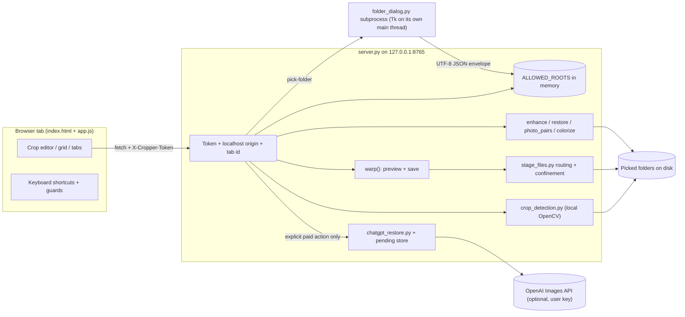

# Architecture

_Last updated: 2026-11-16. Describes the development line at `43147ef`
(`fix/editor-shortcuts`). `main`/`stable-v1` is an older, smaller version of the
same shape (one server, one page, no Settings, no AI)._

## Components

Cropper is a **local Python HTTP server** plus a **single-page browser UI**. Nothing
runs in the cloud except the optional OpenAI calls.

| Piece | Role |
|---|---|
| `server.py` | `ThreadingHTTPServer` bound to `127.0.0.1`. Serves the UI and the `/api/*` JSON endpoints, holds per-tab state (allowed roots, batches, confirmation tokens), and does crop/warp/save. Port **8765** by default; `--port` wins, else `CROPPER_PORT`, else 8765. `--data-dir` sets the per-user data folder (default `%APPDATA%\Cropper`). `--no-browser` skips opening a browser. |
| `index.html`, `app.js`, `app.css` (+ `chatgpt.css`, `stage-routing.css`) | Browser UI: folder/grid, crop editor (SVG overlay, keyboard shortcuts, live preview), Front + Back, Enhance/Repair, AI tabs, Settings. Talks to the server with `fetch` and the `X-Cropper-Token` / `X-Cropper-Tab` headers. |
| `crop_detection.py` | Local OpenCV corner prediction (`predict_corners`). Suggestions only; never saves. |
| `folder_dialog.py` | Native folder picker, run as a **one-shot subprocess**. The only module that imports `tkinter`. |
| `stage_files.py` | Flat batch routing (stage folders and `_c`/`_e`/`_ai`/`_col` suffixes), path safety (`resolve_in_allowed_roots`, `path_key`, `same_path`, write confinement), verified multi-file saves and rollbacks. |
| `app_settings.py` | Settings JSON in the data dir; API key in Windows Credential Manager via `keyring` (masked in responses; `OPENAI_API_KEY` overrides). |
| `enhance.py`, `restore.py` | Local auto-improve and repairs (dust, noise, sharpen). |
| `photo_pairs.py` | Visual front/back pair suggestions and durable, user-approved links. |
| `colorize.py` | Local B&W/sepia classification and colour-only blending of an AI result. |
| `chatgpt_restore.py`, `chatgpt_pending.py`, `image_api_errors.py` | Optional OpenAI Images edits, the pending-review store (survives restarts), and plain-language API error mapping. |
| `e2e_server.py` | **Test-only** entry that stubs the folder dialog. Not used in production. |
| `Start Cropper.cmd` | Windows launcher: `python server.py`. |

## Request security model

1. **Session token.** `TOKEN` is random per server process. `GET /api/session`
   returns it only to localhost. Every other endpoint needs `X-Cropper-Token`
   (constant-time compare), a localhost `Host` on the bound port, and, when an
   `Origin` header is present, an origin matching this server.
2. **Tabs.** Each browser tab registers a random id (`POST /api/tab-register`). State
   is keyed by `(session, tab)`. At most 32 tabs; the least-recently-used *idle* tab
   is evicted after 15 minutes idle or when the cap is hit.
3. **ALLOWED_ROOTS.** `ALLOWED_ROOTS[(session, tab)]` is an **in-memory** set of
   folder keys. A folder is added **only** by a real pick in the native dialog
   (`POST /api/pick-folder` → `register_allowed_root`). Drive/filesystem roots and
   parents of an already-open folder are refused. Nothing is persisted, so after a
   restart every folder must be picked again.
4. **Reads and writes are confined.** Image reads go through
   `resolve_in_allowed_roots`; every write plan is confined to the tab's roots
   (symlink/junction and traversal escapes fail). Listing (`/api/folders`,
   `/api/list`) is allowed anywhere but grants nothing.
5. **`GET /api/folder-status?path=…` returns `{"registered": true|false}`.** It is
   read-only: it registers nothing, returns no listing, and reports escapes the same
   as a missing path. The UI uses it on startup to show the "pick this folder again"
   empty state instead of failing tile loads.
6. **Confirmations.** Overwrite and replace-original need short-lived (15 min),
   tab-scoped tokens tied to a server-side snapshot of the batch.

## Folder dialog subprocess

Tk/Tcl 8.6 on Windows crashes the process (`Tcl_AsyncDelete`) if a Tk root is
created, destroyed or garbage-collected off the process's main thread. Every
request in `ThreadingHTTPServer` runs on a worker thread, so Tk must never live in
the server. Instead:

- `choose_folder_dialog()` takes a non-blocking lock (one dialog at a time; a second
  request gets `A folder dialog is already open.`), then a worker thread starts
  `sys.executable -I -X utf8 folder_dialog.py` with `stdin=DEVNULL`, and
  `CREATE_NO_WINDOW` on Windows.
- The child creates Tk on **its own** main thread and writes exactly one **UTF-8
  JSON envelope** to stdout as bytes: `{"path": "<absolute path>"}` or
  `{"cancelled": true}`. Writing bytes avoids the Windows console code page, so
  non-ASCII folder names round-trip.
- The server drains both pipes, caps combined output at 32 KiB, times out after
  300 s (killing the child), and accepts only an envelope with exactly those keys.
  The path must be absolute, ≤ 4096 chars, and free of newline/CR/NUL, and is then
  registered verbatim. Children are killed at exit.

## Corner-detection pipeline

`POST /api/crop-corners {path, target?}` → `request_image` (allowed-root check) →
`load_image` (full decode, EXIF transpose, RGB) → `predict_corners`:

1. Thumbnail to 960 px (thresholds are tuned for this scale).
2. Build channels: grey + Lab L/a/b. Edge map from Canny on each; Otsu masks and
   colour-distance-from-border masks (thresholds 12/20/30) as extra evidence.
3. Find contours at several Canny thresholds and closing kernels; approximate quads.
4. Filter: convex, not hugging the frame, 6–97 % of the area, sane side ratios and
   angles, edge support ≥ 55 %, colour contrast across each side ≥ 35 %.
5. Score (area, edge support, contrast, centrality, squareness). If `target` is
   given, keep only quads containing that point. Deduplicate; return up to 8
   candidates scaled back to original pixels, plus `elapsed_ms`.

The client caches results for the current image (`[path, mtime]` + target), so a
repeat **P** cycles candidates without a request. A request token
(path + modified time) is checked when the result lands, so a late result cannot
apply to a different image. **W** bumps the request id so a late predict cannot
overwrite the whole-image selection.

**Measured (16 Nov 2026):** cold press p95 ≈ 390–490 ms; ~75 % of detection is
pure-Python scoring of near-duplicate quads. The approved speed package
(ADR-007) vectorises scoring with dedupe first, adds decoded-preview and result
caches, and prefetches the current and next image on one background worker.

## Warp, preview and save

- `warp(image, points, rotation, aspect_ratio)` in `server.py`:
  `order_corners` (any click order → TL, TR, BR, BL; must form a convex quad) →
  output size from the longest opposite sides, expanded to the chosen proportion
  (0.2–5) → `cv2.getPerspectiveTransform` + `warpPerspective` (cubic,
  replicate border) → optional 90° rotation. Refuses > 200 MP.
- **Preview:** `POST /api/crop-preview` decodes, thumbnails to 1400 px, scales the
  points and calls the same `warp`, returning a JPEG. The UI debounces it (180 ms).
- **Save:** `POST /api/crop` plans the destination (`stage_files.plan`), confines
  writes, checks confirmations, then `save_image` → `warp` at full resolution →
  encode to the source format, keeping ICC and non-GPS EXIF (GPS only if enabled).
- Because preview and save share `warp`, any correction belongs **inside `warp`**.
  The approved bowed-edge correction (ADR-008) will live there: per-side quadratic
  sag fit with corners fixed, a Coons-patch remap, and a capped, gated trim as a
  safety net, controlled by a Settings toggle (default on).

## Key API endpoints

| Method | Path | Purpose |
|---|---|---|
| GET | `/api/session` | Token for this process (localhost only). |
| POST | `/api/tab-register` | Register a random tab id. |
| POST | `/api/pick-folder` | Open the native dialog; register the pick as an allowed root; start a batch snapshot. |
| GET | `/api/folder-status` | `{registered}` for a path; read-only. |
| GET | `/api/folders`, `/api/list` | Browse folders / list images (grants nothing). |
| GET | `/api/image`, `/api/thumb`, `/api/info` | Screen image, thumbnail, dimensions (confined). |
| POST | `/api/crop-corners` | Local corner prediction. |
| POST | `/api/crop-preview` | Straightened preview JPEG. |
| POST | `/api/crop` | Save a crop (with overwrite/replace confirmation). |
| POST | `/api/overwrite-preview`, `/api/confirm-overwrite-batch`, `/api/begin-batch` | Conflict preview, batch confirmation, batch snapshot. |
| POST | `/api/merge` | Front + Back composite. |
| POST/GET | `/api/photo-pair-suggestions`, `/api/photo-link`, `/api/photo-links` | Local visual pair suggestions and approved front/back links. |
| POST | `/api/stage-finish` | Finish selected sources: file unchanged stage snapshots and clear them from the queue. |
| POST | `/api/colorization-candidates` | Local B&W/sepia scan of a folder. |
| POST | `/api/enhance`, `/api/restore` (+ previews) | Local auto-improve and repairs. |
| GET/POST | `/api/settings`, `/api/settings/clear-key`, `/api/settings/test-key` | Settings and key management (test-key calls OpenAI). |
| POST | `/api/chatgpt-generate`, `/api/chatgpt-resubmit` | **Paid** OpenAI edits (explicit user action only). |
| GET/POST | `/api/chatgpt-pending`, `/api/chatgpt-accept`, `/api/chatgpt-reject`, `/api/chatgpt-recovered-*` | Pending-review store. |

## Diagram

